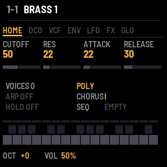

# J6: a JUNO-60 style firmware for the M-VAVE FM-1

A six-voice polysynth after the Roland JUNO-60 for the M-VAVE FM-1, built on
[fm1-base](https://github.com/charlesvestal/fm1-base) (MPL-2.0) and [felucca-bsp](https://github.com/hugelton/felucca-bsp).
Independent project, not affiliated with Roland. The sound is an approximation, not a circuit model.

**New to J6? Read the [beginner's guide](docs/GUIDE.md).**



## Features
- **Voices:** 6, one DCO each: band-limited saw, pulse (manual width or LFO PWM), sub square, noise; 16'/8'/4' range
- **Filter:** 24 dB resonant low-pass (self-oscillates), 4-position HPF (boost / flat / thin / thinner), key follow
- **Envelope:** one ADSR shared by VCF and VCA (inverted option, gate VCA)
- **LFO:** rate, delay, to pitch, to cutoff, PWM; the key pressure also moves its depth
- **Chorus:** stereo, off / I / II / I+II
- **Play modes:** Poly, Unison (with spread), Solo; portamento; bend range; hold
- **Arpeggiator:** up / down / up-down, 1-3 octaves, rate
- **Recorder / sequencer:** 16 steps with rests, tempo follows the ARP rate, saved with SAVE
- **Memories:** 56 (16 factory sounds, the rest INIT), stored in flash; MIDI program change selects
- **MIDI:** note, velocity, pitch bend, mod wheel (CC1), sustain (CC64), channel pressure, program change
- **UI:** page tabs, six colour themes (JUNO blue by default, GREEN, AMBER, CYAN, RED, MONO), status page with a pattern strip

## Controls
| Control | Action |
|---|---|
| HOME | status page (sound name, mode, arp / hold / seq state, 16-step pattern strip) |
| EDIT / SEL / ENV / LFO / FX / GLO | pages DCO, VCF+HPF, envelope, LFO, chorus+mode+porta, global. Press the button again for the page's second half; DCO, VCF and GLO have two |
| K1..K4 | the four values shown |
| SELECT encoder | flip a page's halves |
| PRESET / ALGO encoders | memory ±1 / ±8 |
| SAVE | store the sound, settings and pattern (lit when something changed) |
| ARP | arpeggiator on/off; while recording, inserts a rest; says "SEQ RUNNING" if the sequence plays |
| PLAY | hold on/off |
| REC | start recording (clears the pattern, play keys, ARP = rest); press again to finish |
| SEQ | play / stop the pattern ("EMPTY: REC" if none). Starting it turns the arp off |
| OCT- / OCT+ | octave; **both together = panic** (all notes off, stops the sequence and recording) |
| Touch keys | the 27-key keyboard |

GLO page 2 holds TEMPO (the arp/sequence rate), THEME and LINK.

## LINK: drive a second FM-1 (beta)
> **Beta feature.** LINK is new and under review with the S1Vave maintainer; behaviour may change in later releases.

Two FM-1s can be wired together over USB. Set **GLO page 2, K3 (LINK) to HOST** and the FM-1's USB port becomes a USB-MIDI
**host**: whatever the arpeggiator and sequencer play (and the touch keys, when the arp is off) is also sent as MIDI
notes on channel 1 to the other unit, which stays an ordinary USB device. The other FM-1 can run J6, or any firmware
with class-compliant USB-MIDI, for example [S1Vave](https://github.com/AndrewGG88/S1Vave).
- The FM-1 does not supply 5 V on its USB port in host mode: connect the two through a **powered USB hub or powered
  adapter** (no nested hubs, no low-speed devices).
- Only one side can be host. The other FM-1 must be in its normal device mode, with LINK off.
- LINK is never saved, so J6 always boots as a device and the installer keeps working. In host mode there is no
  computer on the port (no USB audio or installer): switch LINK off to go back.
- The screen shows LINK (bright when connected). Panic and a lost cable send all-notes-off; notes that arrived over MIDI
  and are then arpeggiated are forwarded too. MIDI clock is not sent yet.
- Host mode is new and has had limited testing on real hardware.

## Install
Download `j6-1.3.0.fwsc` from the [releases](../../releases) and install it with the
[Firmware Hub](https://thefirmwarehub.com) installer or `python fm1-base/tools/fm1_install.py j6-1.3.0.fwsc`.
The package carries the felucca update loader, so you can leave J6 by installing any other FM-1 firmware the same way.
Flashing custom firmware is at your own risk.

## What it keeps
J6 keeps only its own data: its 56 memories, settings and sequencer pattern. It **does not read the projects, samples
or settings of other firmwares**, and they cannot read J6's.

## Build
Host simulator (any OS with a C compiler and Python + Pillow):
```
python fm1-base/tools/build.py . --host
build/host/j6_host tests/basic.txt build/host     # runs the script, writes screenshots and a WAV
```
On Windows with MinGW see `shim/`: `set PYTHONPATH=shim`, `set CC=shim\cc.bat`.

Engine test (levels, NaN, voice counts, CPU), then `python tests/analyze.py OUT` for spectra:
```
gcc -O2 -ffp-contract=off -I fm1-base/include -o engine_test tests/engine_test.c src/juno.c -lm
```

Firmware, Linux: set `JIELI_TOOLCHAIN` and `AC79_SDK` (see `fm1-base/README.md`), then `./build.sh` → `build/j6.fwsc`
(`./build.sh --release 1.3.0` → `build/j6-1.3.0.fwsc`, identity `FM-1_66010300`).
Windows: Docker Desktop, then `.\build_device.ps1` (see the script header for the toolchain layout).
Pushing a `vX.Y.Z` tag builds, signs and releases through GitHub Actions.

## Status
Host simulator and engine tests pass. Real CPU headroom (`app_overload` sheds voices if the render runs late), the
exact output level and the chorus / HPF values are by ear-of-the-spec, not measured from hardware.

## Licence and credits
MPL-2.0 (`LICENSE`). Built on fm1-base (Charles Vestal, Leo Kuroshita) and felucca-bsp, vendored here under their own
MPL-2.0 licences. `fm1-base/tools/build.py` has one local change (POSIX container paths on Windows).
